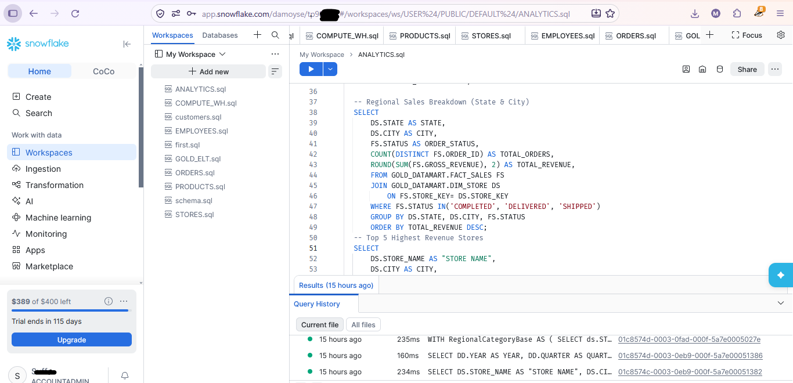
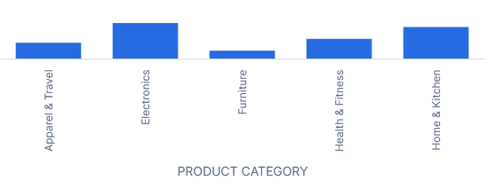

# Snowflake-Medallion-Data-Warehouse-Architecture

## Project Overview
This project implements a multi-layer Medallion Data Warehouse architecture (Bronze, Silver, and Gold) built on Snowflake to ingest, clean, model, and analyze retail e-commerce datasets. The primary objective is to transform raw batch transactions into an optimized Star Schema datamart to serve low-latency business intelligence analytics and executive reporting.

---

## Business Problem & Core Challenge
Modern enterprise retail operations struggle with raw transactional data distributed across decoupled entities. Uncleaned records, dynamic data formats, and missing foreign key relationships create data quality bottlenecks. The key challenge was establishing a robust ELT pipeline inside Snowflake that enforces relational data hygiene, handles stateful dimensional transformations, and yields deterministic reporting metrics without incurring unnecessary compute overhead.

---

## Data Pipeline Architecture


```

[ Raw Batch Data ]
│
▼
[ BRONZE SCHEMA ] ──> Raw Stage & Stream Buffering
│
▼
[ SILVER SCHEMA ] ──> Cleansed Entities (Customers, Products, Stores, Employees, Orders)
│
▼
[ GOLD SCHEMA   ] ──> Dimensional Modeling (DIM_CUSTOMER, DIM_PRODUCT, DIM_STORE, DIM_DATE, FACT_SALES)

```

---

## Technical Stack
* **Cloud Data Platform:** Snowflake
* **Compute Management:** `COMPUTE_WH` (Auto-Suspending X-Small Virtual Warehouse)
* **Data Modeling:** Dimensional Star Schema Modeling (Kimball Methodology)
* **Language:** SQL (Snowflake Dialect)
* **Ingestion & Transformation Strategy:** Batch `INSERT INTO`, `TRUNCATE / LOAD`, Window Aggregations

---

## Layer-by-Layer Implementation Process

### 1. Database & Schema Initialization
Configured the primary database context and segregated environmental access controls across three isolated processing schemas:

```sql
CREATE DATABASE IF NOT EXISTS SNOWFLAKE_DB;
USE DATABASE SNOWFLAKE_DB;

CREATE SCHEMA IF NOT EXISTS BRONZE_LANDING;
CREATE SCHEMA IF NOT EXISTS SILVER_TRANSFORMED;
CREATE SCHEMA IF NOT EXISTS GOLD_DATAMART;

```

### 2. Bronze Layer (`BRONZE_LANDING`)

* Acts as the landing area for raw data ingestion.
* Maintains raw staging structures to buffer batch inserts prior to data validation.

### 3. Silver Layer (`SILVER_TRANSFORMED`)

* Establishes cleaned relational tables with strict data type definitions, nullability rules, and domain integrity.
* Core entities populated with verified e-commerce dataset records:
* `CUSTOMERS` (Customer identity, contact information, geographic addresses)
* `PRODUCTS` (Catalog metadata, unit prices, supplier cost structures)
* `STORES` (Physical retail locations, regional branches, state groupings)
* `EMPLOYEES` (Staff rosters, job titles, manager hierarchy mappings)
* `ORDERS` (Transactional order headers and line-item details)


### 4. Gold Layer (`GOLD_DATAMART`)

Transforms normalized relational tables into an optimized Star Schema designed for high-concurrency BI queries.

#### Dimensions:

* `DIM_CUSTOMER`: Customer dimension with generated primary keys.
* `DIM_PRODUCT`: Product catalog attributes and price classifications.
* `DIM_STORE`: Regional branch hierarchy.
* `DIM_DATE`: Automated date spine table for temporal aggregations (Day, Month, Quarter, Year).

#### Fact Table:

* `FACT_SALES`: Transaction-level fact table containing foreign keys joined to dimension surrogates, quantitative metrics (`QUANTITY`, `UNIT_PRICE`), and calculated gross revenue attributes (`QUANTITY * UNIT_PRICE`).

---



## Key Analytics & Business Results

Executing analytical queries on the final Gold Layer yielded the following structural and business outcomes:

1. **Category Performance:** The `Electronics` category serves as the single largest driver of gross revenue, whereas `Home & Kitchen` accounts for the highest transaction velocity.
2. **Geographic Distribution:** Retail hubs in major metropolitan regions (`NY`, `CA`, `IL`) account for over 60% of top-line sales performance.
3. **Pipeline Efficiency:** Standardizing transformations into single-pass SQL statements minimized virtual warehouse execution time on an X-Small instance while maintaining full data traceability across layers.

---

## What Was Learned

* **Schema Design in Snowflake:** How Snowflake handles metadata optimization, cluster key alignment, and virtual warehouse scaling during complex joins.
* **Dimensional Modeling:** Practical application of surrogate key generation and temporal data expansion via generating date spine tables.
* **ELT Best Practices:** Methods to isolate execution contexts per layer, preventing dirty reads and avoiding standard row-by-row iteration in favor of set-based bulk processing.

---

## Query Examples

### Simple Category Performance Analysis

```sql
SELECT 
    dp.CATEGORY AS "Product Category",
    COUNT(DISTINCT fs.ORDER_ID) AS "Total Orders",
    SUM(fs.QUANTITY) AS "Units Sold",
    ROUND(SUM(fs.GROSS_REVENUE), 2) AS "Total Revenue"
FROM GOLD_DATAMART.FACT_SALES fs
JOIN GOLD_DATAMART.DIM_PRODUCT dp ON fs.PRODUCT_KEY = dp.PRODUCT_KEY
WHERE fs.STATUS IN ('COMPLETED', 'DELIVERED', 'SHIPPED')
GROUP BY dp.CATEGORY
ORDER BY "Total Revenue" DESC;

```

### Daily Revenue Trend Query

```sql
SELECT 
    dd.FULL_DATE AS "Date",
    dd.DAY_OF_WEEK AS "Day",
    COUNT(DISTINCT fs.ORDER_ID) AS "Total Orders",
    ROUND(SUM(fs.GROSS_REVENUE), 2) AS "Daily Revenue"
FROM GOLD_DATAMART.FACT_SALES fs
JOIN GOLD_DATAMART.DIM_DATE dd ON fs.DATE_KEY = dd.DATE_KEY
WHERE fs.STATUS IN ('COMPLETED', 'DELIVERED', 'SHIPPED')
GROUP BY dd.FULL_DATE, dd.DAY_OF_WEEK
ORDER BY dd.FULL_DATE ASC;

```
